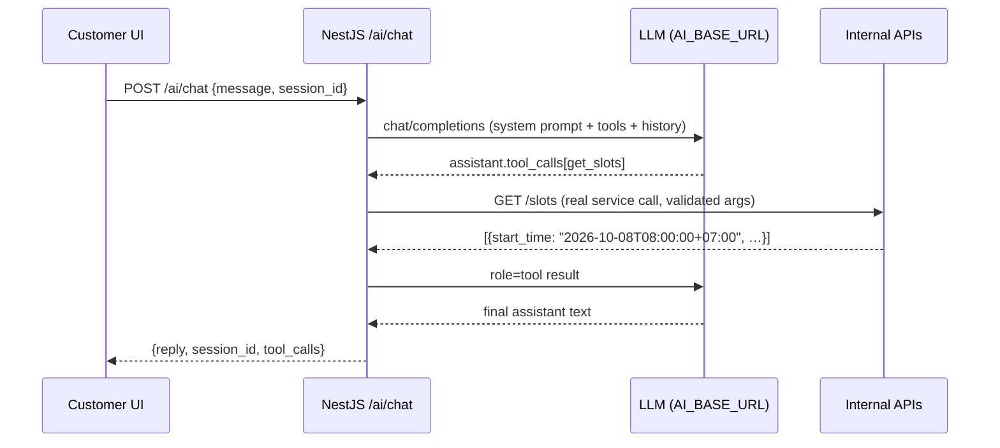

# API.md — Booking Salon/Spa

Base URL: `http://localhost:8100` (harness contract). JSON everywhere. All messages are Vietnamese.
Auth: `Authorization: Bearer <access_token>` (JWT, 15 min) + rotating refresh token (7 days, hashed in DB).

**Frozen surface**: the routes marked ★ are called by the harness checker — paths, field names and
status codes below must not change. Everything else is additive.

## Error shape (every error response)

```json
{ "statusCode": 409, "error": "Conflict",
  "message": "Khung giờ này đã được đặt. Vui lòng chọn khung giờ khác.",
  "requestId": "0f3c…" }
```
Clients may read `error` or `message` (both are Vietnamese for 4xx paths). 400 validation /
409 overlap / 401 missing-or-invalid token / 403 wrong scope / 404 unknown resource / 429 rate limit.

## Auth
| Route | Auth | Body → Response |
|---|---|---|
| ★ `POST /auth/login` | public | `{email,password}` → `200 {access_token, refresh_token, expires_in, user{id,email,role,name,branch_id,stylist_id}}`; wrong credentials → 401. Rate limited 20/60s/IP. |
| `POST /auth/refresh` | public | `{refresh_token}` → new token pair (old one revoked + rotated). |
| `POST /auth/logout` | bearer | `{refresh_token}` → `204`; token revoked. |
| `GET /auth/me` | bearer | current user + linked branch/stylist. |

## Catalog (public)
| Route | Response |
|---|---|
| ★ `GET /branches` | `[{id,name,address,open_time,close_time}]` ordered by `id` asc. |
| ★ `GET /branches/{branchId}/services` | `[{id,name,price,duration_minutes,description}]` (`duration_minutes`; DTOs also accept/echo `duration` alias). |
| ★ `GET /branches/{branchId}/stylists` | `[{id,name,branch_id,is_active}]`. |
| `GET /services/{id}` | single service. |

## Slots
| Route | Response |
|---|---|
| ★ `GET /slots?branch_id=&stylist_id=&service_id=&date=YYYY-MM-DD` | `[{start_time,end_time,stylist_id,duration_minutes}]`, `start_time` ISO-8601 with `+07:00`; `date` interpreted in Asia/Ho_Chi_Minh. |

Computation (§4.2): `working_hours(stylist, weekday)` ∩ `branch open hours` − `time_off` −
non-cancelled `bookings`, stepping `SLOT_STEP_MINUTES` (15) and requiring
`start + service.duration ≤ range end`. Cached in Redis `slots:{branch}:{stylist}:{date}:{service}`
TTL 30s, invalidated on booking create/cancel/reschedule.

## Bookings
| Route | Auth | Notes |
|---|---|---|
| ★ `POST /bookings` | public | `{branch_id,service_id,stylist_id,start_time,customer_name,customer_phone,customer_email?,note?,source?}` → `201 {id,status,start_time,end_time,deposit_status,deposit_amount,discount_amount,price,branch_id,service_id,stylist_id,customer{id,name,phone}}`. 409 on overlap, 400 outside working hours / on time off / invalid phone or email / past time. Rate limited 600/60s/IP (contract needs ≥60/min). |
| ★ `GET /bookings/{id}` | public | same shape as the POST response. |
| ★ `POST /bookings/{id}/cancel` | public (id is the secret) | `200 {id,status:"cancelled"}`; `< 24h` before start → 409 with Vietnamese message; cancelling frees the slot + removes reminders. |
| `POST /bookings/{id}/reschedule` | public | `{start_time, stylist_id?}` → re-runs the full create-time validation incl. overlap lock; requires ≥24h before the **old** start; reschedules reminders. |
| ★ `POST /bookings/{id}/complete` | bearer `super_admin` \| `branch_admin` of that branch | any non-cancelled booking, no time precondition → `200 {status:"completed"}`; credits loyalty exactly once. |
| `POST /bookings/{id}/no-show` | bearer `super_admin` \| `branch_admin` of that branch | `200 {status:"no_show"}`. |
| `GET /bookings?phone=` | public | Tra cứu của khách theo SĐT: trả về lịch hẹn (id, trạng thái, giờ, chi nhánh/dịch vụ/stylist, tiền) — **không** trả PII của khách (tên/email/SĐT) để endpoint công khai không bị dùng để liệt kê dữ liệu khách hàng. |
| `GET /admin/bookings?branch_id=&from=&to=&status=` | bearer staff | branch-scoped list (calendar source). |
| `PATCH /admin/bookings/{id}/status` | bearer staff | `{status: "completed"|"cancelled"|"no_show"}` (giá trị khác → 400). branch_admin chỉ thao tác được lịch của chi nhánh mình → 403. |

## Payments
| Route | Notes |
|---|---|
| ★ `POST /bookings/{id}/deposit` | VNPay configured → `200 {payment_url, txn_ref, amount, provider:"vnpay"}`; not configured → `400` Vietnamese error “Cổng thanh toán VNPay chưa được cấu hình…”. `txn_ref` = booking id. |
| `POST /bookings/{id}/deposit?provider=momo` | same shape for Momo when `MOMO_*` is configured. |
| ★ `POST /webhooks/vnpay` | flat JSON of `vnp_*` fields. Verify `vnp_SecureHash` = lowercase hex HMAC-SHA512 over all other `vnp_*` sorted by key asc, `k=v` joined by `&`, secret `VNPAY_HASH_SECRET`. Valid → `200 {status:"ok"\|"already_processed"}` + `deposit_status=paid` (exactly once per `(provider, txn_ref)`); invalid signature or missing secret → `400`. |
| `POST /webhooks/momo` | HMAC-SHA256 over the Momo canonical string, same idempotency rule. |

Raw webhook payloads are persisted in `payment_transactions.raw_payload` for reconciliation (§2.5).

## Admin / analytics
| Route | Auth | Notes |
|---|---|---|
| ★ `GET /admin/revenue?branch_id=&from=&to=` | bearer staff | `200 {total_revenue, currency:"VND", completed_bookings, by_branch[], by_day[], by_month[]}`; `total_revenue` = Σ(`price − discount_amount`) over `completed` bookings; `branch_admin` asking another branch → 403; missing/invalid token → 401. |
| `GET /admin/dashboard?branch_id=&date=` | bearer staff | KPI band for the admin overview tier (today's bookings, revenue, cancellations, utilisation). |
| `GET /admin/analytics/top-services?branch_id=&from=&to=` | bearer staff | analytics tool surface (§2.9) — branch scoped. |
| `GET /admin/analytics/top-stylists?branch_id=&from=&to=` | bearer staff | idem. |
| `GET /admin/analytics/cancellation-rate?branch_id=&from=&to=` | bearer staff | idem. |

## CRUD (staff, branching per PRD §2.6)
`POST/PATCH /branches[/{id}]` (super_admin) · `POST/PATCH/DELETE /services[/{id}]` (super_admin, or
branch_admin for own branch) · `POST/PATCH /stylists[/{id}]`, `PUT /stylists/{id}/working-hours`,
`POST /stylists/{id}/time-off`, `DELETE /stylists/{id}/time-off/{timeOffId}` · `GET /stylist/me`,
`GET /stylist/me/bookings?from=&to=` (stylist role).

## AI (§2.8 / §2.9)
| Route | Notes |
|---|---|
| ★ `POST /ai/chat` | `{message, session_id?}` → `200 {reply, session_id, needs_human?, tool_calls[]}`. Not configured → `503` Vietnamese error (no crash). Calls `{AI_BASE_URL}/chat/completions` (OpenAI style, non-streaming). Tools exposed: `get_slots(branch_id,stylist_id,service_id,date)`, `create_booking(branch_id,service_id,stylist_id,start_time,customer_name,customer_phone)`, `get_branch_info(branch_id?)`, `list_branches()`, `request_human_support(reason)`. Whitelist enforced: unknown tool → refused, never executed, refusal returned to the model as the tool result. Tool results (ISO `start_time`) go back to the model; its final text is the `reply`. Rate limited **30/60s/IP** → 429 after that. |
| `POST /ai/admin-chat` | bearer staff. Tools: `get_revenue_summary`, `get_top_services`, `get_top_stylists`, `get_cancellation_rate` — branch scoped to the caller's role; the model never sees another branch's numbers and never generates SQL. |

Session history: Redis `ai:session:{id}` (TTL 1h, last 20 messages); no prompt/reply bodies in logs.



## Critical Files for Implementation
- `backend/src/main.ts` — global prefix/validation/CORS wiring and the exact status-code behaviour.
- `backend/src/bookings/bookings.controller.ts` — the ★ booking surface above.
- `backend/src/bookings/dto/*.ts` — request shapes + Vietnamese validation messages.
- `backend/src/payments/vnpay.adapter.ts` — the frozen webhook signature algorithm.
- `backend/src/ai/ai.controller.ts` — the AI surface and its rate limit metadata.
