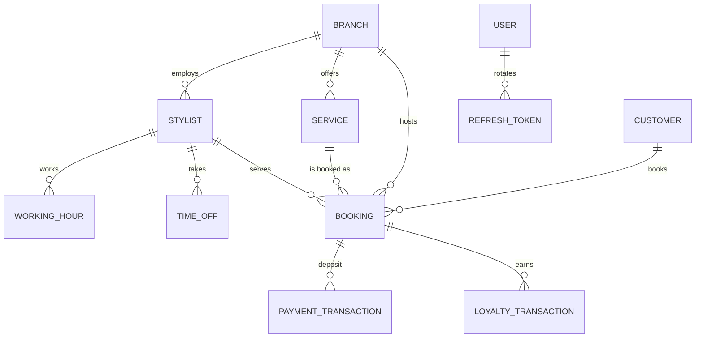

# DATA_MODEL.md — Booking Salon/Spa

Entities follow PRD §3 exactly (Vietnamese product vocabulary: chi nhánh / dịch vụ / stylist / khách hàng / lịch hẹn).
Storage convention: every instant is stored **UTC** (`timestamptz`); all conversions to
`Asia/Ho_Chi_Minh` happen in the application layer (`backend/src/common/time.ts`). Money is integer VND.
Column names in Postgres are snake_case (Prisma `@map`), so the DB matches the PRD's field names.

## Entities

| Entity | Key fields | Constraints | Screens |
|---|---|---|---|
| `branches` | id, name, address, open_time, close_time, is_active | PK id; times are `HH:mm` local | Admin branch switcher, booking step 1 |
| `services` | id, branch_id FK, name, description, price, duration_minutes, is_active | FK → branches; price ≥ 0; duration > 0 | Booking step 2, admin services |
| `stylists` | id, branch_id FK, name, phone, email, is_active | FK → branches | Booking step 3, admin stylists |
| `working_hours` | id, stylist_id FK, day_of_week (0=Sun…6=Sat), start_time, end_time, is_active | FK → stylists; unique (stylist_id, day_of_week, start_time) | Admin stylists |
| `time_off` | id, stylist_id FK, start_time, end_time, reason | FK → stylists; start < end | Admin stylists |
| `customers` | id, name, phone UNIQUE, email, completed_bookings, loyalty_discount_used_at | phone is the identity (VN format, unique) | Admin bookings, AI booking tool |
| `bookings` | id, branch_id, service_id, stylist_id, customer_id, start_time, end_time, status, price, discount_amount, deposit_amount, deposit_status, source, created_at | FKs; **index (stylist_id, start_time, end_time)**, **index (branch_id, start_time)**, index (customer_id, status) | Booking confirm, admin calendar, stylist page |
| `users` | id, email UNIQUE, password_hash, role, branch_id?, stylist_id?, customer_id?, is_active | role ∈ customer/stylist/branch_admin/super_admin | Login, admin shell |
| `refresh_tokens` | id, user_id FK, token_hash UNIQUE, expires_at, revoked_at, replaced_by_id | revocation + rotation for §5 auth | (no UI) |
| `loyalty_transactions` | id, customer_id FK, booking_id?, type (earn/redeem/adjust), points, discount_amount, description, actor, created_at | audit trail for §2.4 | Admin customer detail |
| `payment_transactions` | id, booking_id FK, provider, txn_ref, amount, status, raw_payload JSONB, signature_valid, message, created_at | **UNIQUE (provider, txn_ref)** → idempotent crediting (§2.5/§4) | Booking deposit, admin reconciliation |
| `ai_tool_calls` | id, session_id, tool_name, arguments JSONB, result_preview, success, created_at | audit trail for §5 | (no UI) |
| `ai_sessions` | session_id PK, needs_human, reason, updated_at | handoff marker for §2.8 | Admin AI widget (tier 2) |
| `notifications` | id, booking_id?, channel (email/sms), kind (reminder-24h/reminder-1h), to, status, payload JSONB, created_at | reminder audit for §2.3 | (no UI) |

## Relationships



`Booking` is the join point of the whole model: it carries the (stylist, time range) pair that the
overlap rule and the mandatory index are built on.

## Booking state machine (status)

```
pending ──confirm──► confirmed ──complete──► completed        (loyalty +1, revenue counted)
   │                     │
   └──────cancel─────────┴──────► cancelled        (slots freed, reminders removed)
                       └──────no_show──────► no_show
deposit_status: unpaid ──webhook(valid sig)──► paid   (idempotent per (provider, txn_ref))
```

Rules the schema enforces on top of the state machine:
- `cancelled` / `no_show` bookings never block a slot (overlap queries filter them out).
- `completed` transitions are idempotent: loyalty is credited once per booking
  (`loyalty_transactions` row keyed by booking_id + type `earn`).
- `discount_amount` is 0 unless the customer's completed count hit a loyalty threshold that has not
  been consumed yet (`customers.loyalty_discount_used_at`).

## Indexes (mandated by §3)
- `bookings (stylist_id, start_time, end_time)` — the overlap/`FOR UPDATE` scan.
- `bookings (branch_id, start_time)` — day/week calendar and revenue queries.
- `bookings (customer_id, status)` — loyalty recount.
- `payment_transactions (provider, txn_ref)` UNIQUE — exactly-once crediting.
- `customers (phone)` UNIQUE — customer identity for booking + AI tool.

## Critical Files for Implementation
- `backend/prisma/schema.prisma` — the entities above with their enums, indexes and unique constraints.
- `backend/prisma/migrations/*/migration.sql` — the DDL the harness applies with `prisma migrate deploy`.
- `backend/prisma/seed.ts` — the fixed sample dataset from the run contract §4.
- `backend/src/bookings/overlap.util.ts` — the overlap predicate that gives the two indexes their purpose.
